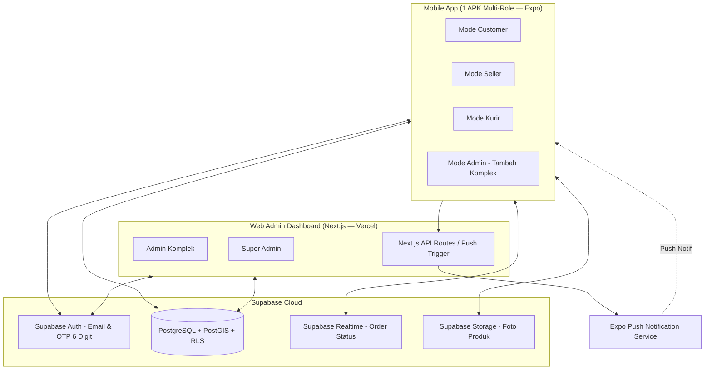
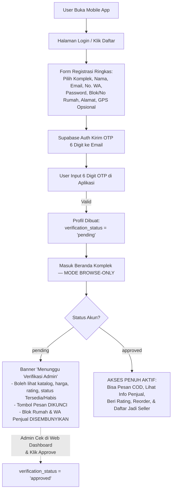
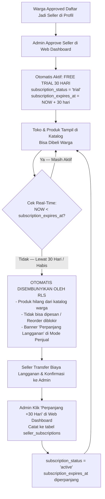
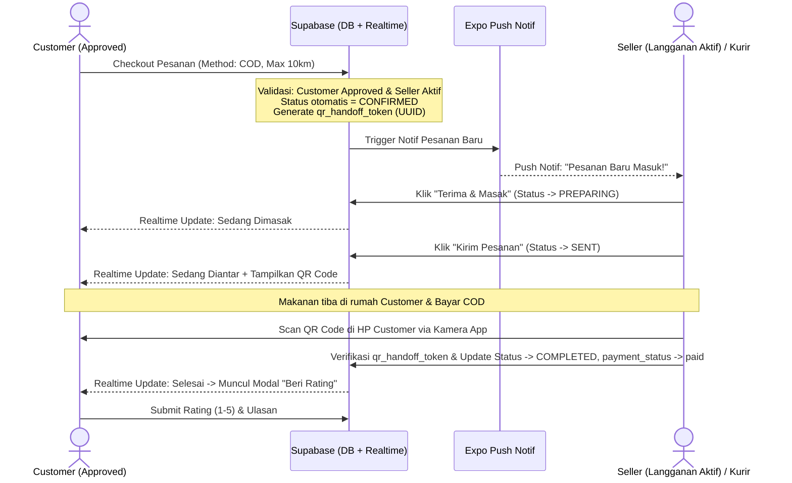
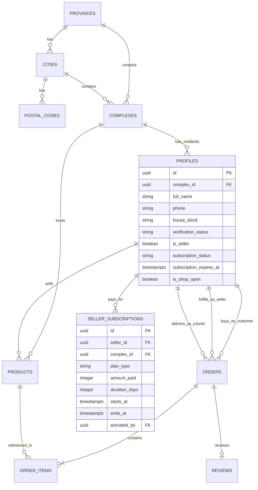

# Master Blueprint & PRD — Aplikasi Katalog Makanan Komplek (MVP)

> **Catatan untuk AI Agent (Google Antigravity):**
> Dokumen ini adalah *Single Source of Truth* untuk seluruh proyek. Patuhi seluruh batasan ruang lingkup (**Fase 1 vs Fase 2**), aturan **Langganan Penjual (Gratis 30 Hari -> Wajib Langganan)**, aturan keamanan (*Row Level Security*), dan standar UI/UX di bawah ini. **Jangan** menambahkan fitur di luar Fase 1 (seperti login WhatsApp, upload KTP, Dark Mode, atau integrasi payment gateway QRIS) kecuali diminta secara eksplisit oleh pengguna.

---

## 1. Ringkasan Proyek & Batasan Ruang Lingkup

### 1.1 Konsep Utama
Aplikasi *hyper-local marketplace* untuk katalog belanja makanan, minuman, dan jajanan yang dijual oleh warga di dalam sebuah komplek perumahan/cluster (termasuk area awal **Kota Serang, Banten** dan Jabodetabek). Hanya warga terdaftar dan terverifikasi yang dapat melakukan pemesanan. Arsitektur database dirancang sejak awal untuk mendukung ekspansi **antar-komplek dengan batas jarak maksimal 10 km**.

### 1.2 Pengelolaan Data Komplek (Mobile & Desktop Web Admin)
* **Admin Komplek & Super Admin** keduanya dapat menambahkan dan mengelola data komplek baru, baik melalui **Desktop Web Admin** maupun langsung melalui **Mobile App (Mode Admin)** yang muncul di *Role Switcher* khusus akun dengan `is_admin = true` atau `is_super_admin = true`.
* Input data komplek mendukung dropdown berjenjang (**Provinsi $\rightarrow$ Kota/Kabupaten $\rightarrow$ Kode Pos**), cakupan **RT/RW**, alamat lengkap, dan **Pin Lokasi GPS** (langsung ambil koordinat HP saat di Mobile App atau klik peta di Web Admin).

### 1.3 Aturan Monetisasi & Langganan Penjual (Wajib di Fase 1)
* **Pembeli (Customer):** 100% Gratis selamanya.
* **Penjual (Seller) — Gratis 30 Hari Pertama (*Free Trial*):** Begitu pengajuan menjadi Penjual disetujui (*approved*) oleh Admin Komplek, sistem otomatis mengaktifkan masa percobaan gratis selama **30 hari** (`subscription_expires_at = NOW() + 30 hari`).
* **Setelah 30 Hari (Wajib Langganan):** Jika masa aktif habis (`subscription_expires_at <= NOW()`), maka secara otomatis di level **Database (RLS)** dan **UI**:
  1. Seluruh produk penjual tersebut **otomatis disembunyikan dari katalog warga**.
  2. Warga **tidak dapat memesan** (termasuk lewat tombol *Reorder*) dari toko yang masa langganannya habis.
  3. Penjual tetap bisa masuk ke *Mode Penjual* untuk melihat daftar menunya, namun muncul banner *"Masa Aktif Toko Habis — Perpanjang Langganan agar dagangan tampil kembali"* beserta tombol hubungi Admin untuk perpanjangan (aktivasi manual oleh Admin di Web Dashboard pada Fase 1).

### 1.4 Pembagian Fase Pengerjaan

| Kategori | Fase 1 (MVP — Fokus Saat Ini) | Fase 2 (Ditunda / Backlog) |
| :--- | :--- | :--- |
| **Autentikasi** | Email + Password + OTP Email 6 Digit (Supabase Auth). Tanpa KTP. | Login/OTP via WhatsApp (jika dibutuhkan nanti). |
| **Status Pending** | Mode **Browse-Only** (hanya lihat katalog kompleknya, tidak bisa pesan, kontak/alamat penjual disembunyikan). | — |
| **Kelola Komplek** | **Admin & Super Admin** bisa tambah/kelola komplek dari **Mobile App (Mode Admin)** & **Desktop Web Admin** (termasuk wilayah Kota Serang). | — |
| **Langganan Seller** | **Gratis 30 Hari** saat *approve*, selanjutnya wajib perpanjang (aktivasi/perpanjang oleh Admin via Web Dashboard). Otomatis sembunyi jika *expired*. | Pembayaran langganan otomatis via Midtrans/Xendit. |
| **Pembayaran Pesanan** | Khusus **COD (Bayar di Tempat)** terlebih dahulu. | Pembayaran otomatis **QRIS** (Midtrans/Xendit). |
| **Komunikasi** | Tombol pintas link WhatsApp (`https://wa.me/...`) khusus user `approved`. | In-App Chat *real-time* (tabel `messages`). |
| **Pengiriman** | Status *real-time* (`CONFIRMED` $\rightarrow$ `PREPARING` $\rightarrow$ `SENT` $\rightarrow$ `COMPLETED`) + **Scan QR Serah Terima**. | Live GPS Tracking kurir di peta (tabel `courier_locations`). |
| **Cakupan Wilayah** | Fokus dalam 1 komplek masing-masing (skema DB & fungsi PostGIS batas **10 km** sudah siap). | Aktifkan toggle pemesanan antar-komplek (radius 10 km). |

---

## 2. Tech Stack & Infrastruktur

| Layer | Teknologi | Keterangan & Paket Utama |
| :--- | :--- | :--- |
| **Mobile App (Android & iOS)** | **React Native + Expo (TypeScript)** | Folder `/mobile-app`. Gunakan **Expo Router**, **NativeWind (Tailwind CSS)**, **TanStack Query**, **Zustand**, `expo-camera` (Scan QR & foto menu), `expo-location` (Pin GPS rumah & komplek), `expo-notifications`, `react-native-qrcode-svg`. |
| **Web Admin Dashboard** | **Next.js (App Router, TypeScript)** | Folder `/web-admin`. Gunakan **Tailwind CSS**, **shadcn/ui**, **Lucide Icons**, **Recharts** (grafik KPI), **TanStack Table**, dan library export CSV/Excel (`papaparse` / `xlsx`). |
| **Backend, DB & Realtime** | **Supabase** | **PostgreSQL** + ekstensi **PostGIS**, **Supabase Auth** (OTP 6 digit email), **Supabase Storage** (foto produk), **Supabase Realtime** (update status pesanan instan). |
| **Notifikasi** | **Expo Push Notifications** | Dikirim melalui Next.js API Route / Supabase Edge Function ke Expo Push API. |
| **Hosting & Testing (Rp 0)** | **Vercel + Expo Go + EAS Build** | Web Admin di Vercel (Hobby); Testing Android via `eas build --profile preview` (file APK); Testing iOS internal via **Expo Go** (tanpa MacBook). |

---

## 3. Diagram Arsitektur & Alur Sistem (Mermaid)

### 3.1 Arsitektur Sistem Keseluruhan



### 3.2 Alur Registrasi Warga, OTP Email & Mode Browse-Only



### 3.3 Alur Langganan Penjual (Gratis 30 Hari $\rightarrow$ Wajib Langganan)



### 3.4 Alur Pesanan COD & Serah Terima QR Code (`SENT` $\rightarrow$ `COMPLETED`)



### 3.5 Entity Relationship Diagram (ERD)



---

## 4. Skema Database Lengkap

Skrip lengkap database (PostgreSQL + PostGIS + RPC Trial 30 Hari + Perpanjangan + QR Handoff + RLS Admin Komplek) tersedia di **`supabase/schema.sql`** dan data awal (termasuk wilayah **Kota Serang, Banten**) di **`supabase/seed.sql`**.

---

## 5. Struktur Folder Proyek (Monorepo Sederhana)

```text
katalog-komplek/
├── BLUEPRINT_ANTIGRAVITY.md       # Dokumen blueprint ini
├── supabase/
│   ├── schema.sql                 # Skrip SQL lengkap
│   └── seed.sql                   # Data contoh wilayah (termasuk Kota Serang) & komplek awal
├── mobile-app/                    # React Native + Expo + NativeWind
│   ├── app/
│   │   ├── (auth)/
│   │   │   ├── login.tsx          # Login Email + Password (tanpa WA/Google)
│   │   │   ├── register.tsx       # Daftar ringkas (Pilih Komplek + Blok Rumah)
│   │   │   └── verify-otp.tsx     # Input OTP 6 digit Email
│   │   ├── (customer)/
│   │   │   ├── _layout.tsx        # Bottom Tabs: Beranda, Pesanan, Profil
│   │   │   ├── index.tsx          # Katalog (hanya produk seller aktif) + Banner Pending
│   │   │   ├── product/[id].tsx   # Detail Makanan (sembunyikan alamat jika pending)
│   │   │   ├── cart.tsx           # Keranjang & Checkout (Khusus COD)
│   │   │   ├── orders/
│   │   │   │   ├── index.tsx      # Pesanan Aktif & Riwayat (+ Tombol Reorder)
│   │   │   │   └── [id].tsx       # Tracker Status Real-time + QR Code Serah Terima
│   │   │   └── profile.tsx        # Role Switcher (Pembeli/Penjual/Kurir/Admin) + Daftar Seller
│   │   ├── (seller)/
│   │   │   ├── index.tsx          # Dashboard Seller + Banner Sisa Hari Trial/Langganan
│   │   │   ├── subscription.tsx   # Info Status Langganan, Riwayat & Tombol Perpanjang via Admin
│   │   │   ├── menu.tsx           # Kelola Menu + Toggle Cepat Tersedia/Habis
│   │   │   └── scan-qr.tsx        # Kamera Scan QR Code Pembeli (SENT -> COMPLETED)
│   │   ├── (courier)/
│   │   │   ├── index.tsx          # Daftar Tugas Antar Komplek
│   │   │   └── scan-qr.tsx        # Kamera Scan QR Serah Terima
│   │   └── (admin)/               # Mode Admin di Mobile (khusus is_admin / is_super_admin)
│   │       ├── complexes.tsx      # Daftar Komplek & Tombol Tambah Komplek Baru
│   │       └── add-complex.tsx    # Form Tambah Komplek (Dropdown Wilayah + RT/RW + Ambil GPS HP)
│   ├── components/                # Komponen UI reusable (ProductCard, StatusBadge, dll.)
│   ├── lib/
│   │   ├── supabase.ts            # Konfigurasi Supabase Client + AsyncStorage
│   │   └── notifications.ts       # Setup Expo Push Token
│   └── store/
│       └── useAppStore.ts         # State keranjang & Active Role (Zustand)
└── web-admin/                     # Next.js (App Router) + shadcn/ui
    ├── src/
    │   ├── app/
    │   │   ├── login/page.tsx     # Login Admin / Super Admin
    │   │   ├── dashboard/
    │   │   │   ├── page.tsx               # KPI (Transaksi, Seller Aktif/Trial/Expired, Status Pesanan)
    │   │   │   ├── verifications/page.tsx # Verifikasi Warga & Pengajuan Seller (Approve + Trial 30 Hari)
    │   │   │   ├── subscriptions/page.tsx # Kelola Langganan Seller (Sisa Hari, Perpanjang +30 Hari, Log Pemasukan)
    │   │   │   ├── users/page.tsx         # Manajemen Warga & Toggle Kurir
    │   │   │   ├── orders/page.tsx        # Monitor Pesanan Real-time + Export CSV/Excel
    │   │   │   └── complexes/
    │   │   │       ├── page.tsx           # Daftar Komplek (Admin & Super Admin)
    │   │   │       └── new/page.tsx       # Form Tambah Komplek (Dropdown Wilayah + Pin Map + Harga Langganan)
    │   │   └── api/
    │   │       └── push/route.ts          # Endpoint kirim Expo Push Notification
    │   └── lib/supabase/                  # Supabase SSR client (server.ts & client.ts)
```

---

## 6. Design System & Aturan UI/UX

* **Mode Warna:** **Light Mode Only** (jangan buat toggle Dark Mode).
* **Palet Warna:**
  * Primary Brand: **Warm Terracotta Orange** (`#EA580C`), Hover/Gradient (`#F97316`).
  * Background Utama: **Pure White** (`#FFFFFF`) & **Soft Slate** (`#F8FAFC`).
  * Teks Utama: **Deep Charcoal** (`#1E293B`), Teks Sekunder (`#64748B`).
  * Status Badges: Tersedia/Approved/Langganan Aktif (`#16A34A`), Pending/Trial/Hampir Habis (`#D97706`), Habis/Ditolak/Expired (`#DC2626` atau `#94A3B8`).
* **Bahasa:** 100% **Bahasa Indonesia** yang ramah dan natural untuk warga komplek.
* **Sudut & Bayangan:** Sudut membulat modern (`rounded-2xl` untuk kartu, `rounded-xl` untuk input dan tombol) dengan *border* tipis (`#E2E8F0`).
* **Aset Logo:** Gunakan *App Icon* siluet rumah + sendok garpu + komunitas (putih di atas gradasi oranye) di `/mobile-app/assets/icon.png` dan `adaptive-icon.png`.

---

## 7. Kebutuhan Environment Variables (`.env`)

### `/mobile-app/.env`
```env
EXPO_PUBLIC_SUPABASE_URL=https://your-project-id.supabase.co
EXPO_PUBLIC_SUPABASE_ANON_KEY=your-supabase-anon-key
EXPO_PUBLIC_WEB_API_URL=https://your-web-admin.vercel.app
```

### `/web-admin/.env.local`
```env
NEXT_PUBLIC_SUPABASE_URL=https://your-project-id.supabase.co
NEXT_PUBLIC_SUPABASE_ANON_KEY=your-supabase-anon-key
SUPABASE_SERVICE_ROLE_KEY=your-supabase-service-role-key
```

---

## 8. Guardrails & Roadmap Eksekusi untuk Agent Antigravity

### Aturan Wajib untuk Agent (Jangan Dilanggar)
1. **Kerjakan secara bertahap (1 Sprint per sesi)** — minta konfirmasi pengguna sebelum lanjut ke tahap berikutnya.
2. **Privasi Mode Browse-Only:** Saat `profiles.verification_status === 'pending'`, UI Mobile WAJIB menampilkan banner status, menonaktifkan tombol *"Tambah ke Keranjang / Pesan"*, dan **tidak boleh** merender blok rumah maupun nomor WA penjual.
3. **Strict Auth:** Halaman Login hanya berisi Email & Password. Halaman Verifikasi menggunakan input **6 digit OTP Email** (`supabase.auth.verifyOtp`).
4. **Checkout COD:** Jangan tampilkan opsi pembayaran online/QRIS di UI Checkout Fase 1 (tampilkan hanya *"Bayar di Tempat (COD)"*).
5. **Kelola Komplek di Mobile & Web Admin:** Baik `is_admin` maupun `is_super_admin` harus bisa menambah komplek baru (dropdown berjenjang Provinsi $\rightarrow$ Kota/Kabupaten $\rightarrow$ Kode Pos, RT/RW, Alamat, dan Pin Lokasi GPS) dari **Web Admin** maupun dari **Mobile App (Mode Admin)**.
6. **Aturan Ketat Langganan Seller (30 Hari Gratis $\rightarrow$ Wajib Langganan):**
   * Saat Admin menyetujui pengajuan Seller di Web Dashboard, WAJIB memanggil RPC `approve_seller_with_trial` agar otomatis mendapat masa berlaku tepat **30 hari**.
   * Di Dashboard Seller Mobile, selalu tampilkan status & sisa hari aktif (contoh: *"Masa Gratis: Sisa 12 hari"* atau *"Langganan Habis — Produk Disembunyikan"*). Jika *expired*, tampilkan tombol *"Perpanjang Langganan"* yang mengarah ke informasi transfer/kontak Admin.
   * Penjual yang *expired* **tidak boleh** muncul di katalog maupun bisa dipesan (sudah dikunci di RLS dan wajib dicek juga di UI).
7. **Fitur Reorder:** Tombol *"Pesan Lagi"* di riwayat pesanan harus mengecek bahwa produk masih `is_available = true` **DAN** penjualnya masih memiliki langganan aktif (`subscription_expires_at > NOW()`).

### Urutan Eksekusi Bertahap (Target 4 Minggu / 16 Jam)
* **Tahap 1 (Fondasi & DB):** Inisialisasi `/mobile-app` (Expo + NativeWind) & `/web-admin` (Next.js + shadcn/ui), serta siapkan `supabase/schema.sql` dan `seed.sql` (termasuk Kota Serang).
* **Tahap 2 (Web Admin Dashboard):** Bangun Login Admin, Halaman **Tambah Komplek Baru** (Admin & Super Admin — dropdown Provinsi/Kota/Kode Pos + RT/RW + Pin Peta + Harga Langganan), Halaman **Verifikasi Warga & Seller** (RPC `approve_seller_with_trial` + tombol `wa.me`), Halaman **Kelola Langganan Seller** (RPC `extend_seller_subscription` + log pemasukan), Dashboard KPI, Manajemen Kurir, dan **Export CSV**.
* **Tahap 3 (Mobile Auth, Katalog, Mode Admin & Status Langganan):** Bangun Login, Registrasi Ringkas, Verifikasi OTP 6 Digit, Halaman Katalog dengan **Mode Browse-Only**, Detail Produk, Profil dengan **Role Switcher** (termasuk **Mode Admin -> Tambah Komplek Baru** dengan GPS HP), serta Halaman **Status Langganan Seller**.
* **Tahap 4 (Transaksi COD, QR Handoff, Rating & Rilis Tes):** Bangun Keranjang & Checkout COD, Kelola Menu Seller, Pesanan Masuk & Update Status *Real-time*, **Scan QR Code** (`complete_order_by_qr`), Modal Rating, Tombol Reorder, Expo Push Notifications, dan *build* APK Android preview.